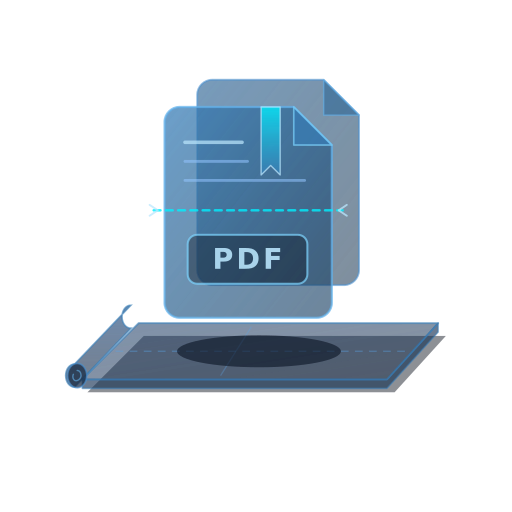

# PDFpanel

<p align="center">
  
</p>

A fast, modern **PDF Toolkit & Bookmark Studio** to **split**, **merge**, **compress**, and **bookmark** PDF files cleanly on **Linux Mint Cinnamon**, powered by GTK 3, Poppler (`libpoppler-glib` / `pdfseparate` / `pdfunite`), and Ghostscript (`gs`). Styled after the **PythonPanel** suite with dark-slate surfaces (`#0b0f19`) and neon cyan accents (`#00f0ff`).

---

## Key Features

### Merge PDFs (`Ctrl + 1`)
- **Ordered Multi-File Combining**: Add multiple PDFs, reorder them cleanly, and customize per-file page ranges (`all`, `1-5`, `2,4,8-10`).
- **Automatic File Bookmarks**: Optionally create a top-level PDF bookmark for each merged source document.

### Split PDFs (`Ctrl + 2`)
- **Fixed Page Chunks**: Split any PDF every *N* pages (or into single-page PDFs).
- **Custom Page Ranges**: Split into multiple outputs using semicolon-separated page specifications (e.g., `1-3; 4-8; 9-12`).
- **Extract Specific Pages**: Pull arbitrary pages (`1, 3, 5-8`) into one clean PDF.
- **Split by Bookmarks / Chapters**: Automatically split right at embedded PDF bookmarks or auto-detected chapter boundaries.

### Compress PDFs (`Ctrl + 3`)
- **Ghostscript Quality Presets**: Choose **Screen (72 dpi)**, **eBook (150 dpi)**, **Printer (300 dpi)**, **Prepress (300 dpi)**, or **Custom Image DPI** with optional grayscale conversion.
- **Instant Savings Report**: Shows before/after file sizes, megabytes saved, and percentage reduction.

### Bookmark Studio (`Ctrl + 4`)
- **Inspect & Edit Outlines**: View existing embedded PDF bookmark hierarchies (`PopplerIndexIter`), edit titles or target pages inline, add top-level chapters or nested subsections, and indent/outdent hierarchy levels.
- **Auto-Populate Chapters**: Automatically detect chapters and sections from printed Table of Contents pages (including multi-column layouts and printed-to-PDF offset calibration), in-body `Chapter`/`Module`/`Unit` headings, or typographic font sizes on blank-bookmark PDFs.
- **Embed & Replace Outlines**: Write standards-compliant Unicode PDF bookmarks (`pdfmark`) directly into the output PDF while keeping pages intact.

### Live Page Preview & DocuPanel Integration
- **Built-in High-DPI Preview Pane**: Inspect page count, dimensions, file size, embedded bookmark count, and preview any page alongside your edits.
- **Open in DocuPanel**: Jump straight to full-screen reading in DocuPanel from *Menu -> Open in DocuPanel...*

---

## Installation

```bash
git clone https://github.com/kyledeanml/pdfpanel.git
cd pdfpanel
./install.sh
```

The installer automatically:
- Installs the vector icon (`pdfpanel.svg`) and multi-size panel icon set (`16x16` through `512x512`) into `~/.local/share/icons/hicolor/`.
- Installs the desktop launcher (`~/.local/share/applications/pdfpanel.desktop`) with `StartupWMClass=pdfpanel`.
- Creates the CLI executable symlink at `~/.local/bin/pdfpanel`.
- Pins **PDFpanel** to your Cinnamon Menu favorites and taskbar panel.

You can launch PDFpanel anytime from the Cinnamon Menu or terminal (`pdfpanel /path/to/file.pdf`).

---

## Keyboard Shortcuts

| Shortcut | Action |
| :--- | :--- |
| `Ctrl + O` | **Open PDF File** |
| `Ctrl + 1` | **Switch to Merge Tool** |
| `Ctrl + 2` | **Switch to Split Tool** |
| `Ctrl + 3` | **Switch to Compress Tool** |
| `Ctrl + 4` | **Switch to Bookmark Studio** |
| `Ctrl + Q` | **Quit Application** |
